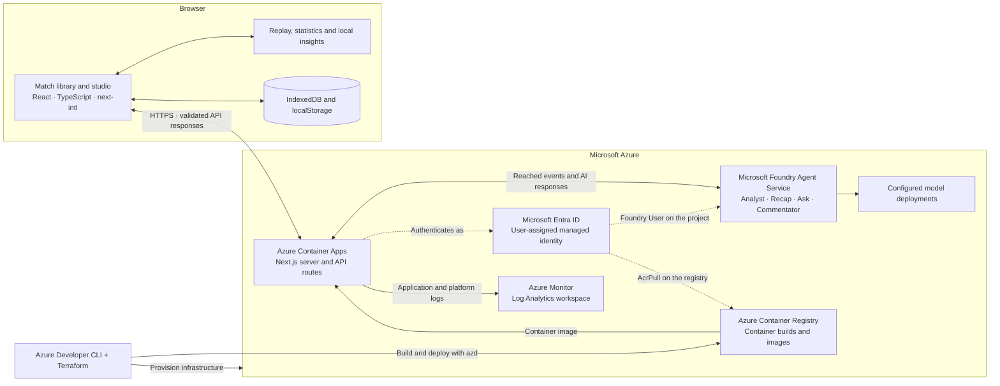

# PitchPulse

A football match analysis studio for replaying recorded events, exploring tactical patterns, and saving notes. PitchPulse combines deterministic match analysis with [Microsoft Foundry agents](#microsoft-foundry-agents) for tactical insights, recaps, questions, and commentary. The bundled Arsenal vs Chelsea demo uses real squad names in a simulated match.

The interface supports seven languages and three perspectives: Casual Fan, Analyst, and Player Focus. Match libraries and notes stay in the browser, which runs replay and rule-based insights locally. The pitch's continuous movement is illustrative. See [DESIGN.md](src/web/DESIGN.md) for the visual specification.

[Architecture](#architecture) · [Development tools](#development-tools) · [Getting started](#getting-started) · [Studio guide](#library-and-studio-guide) · [Foundry agents](#microsoft-foundry-agents) · [Deploy to Azure](#deploy-to-azure)

Repository layout:

- [src/web/](src/web/) is the whole Next.js app: source, tests, scripts, data and its `Dockerfile`. Run npm commands there.
- [infra/](infra/) (Terraform) and [azure.yaml](azure.yaml) make the repository an Azure Developer CLI template; see [Deploy to Azure](#deploy-to-azure).

## Architecture

The browser runs the replay clock, statistics, illustrative movement, and local insights. Azure Container Apps hosts the Next.js server and API routes. When AI analysis is requested, the browser sends only the events reached so far; the server validates them, calls Microsoft Foundry, and checks the returned numbers and evidence before displaying the response.



### Microsoft technology stack

| Technology | Role in PitchPulse | Implementation |
| --- | --- | --- |
| **Microsoft Foundry Agent Service** | Hosts four versioned prompt agents with structured outputs. Their model deployments are selected through `FOUNDRY_MODEL_DEPLOYMENT` and the optional fast deployment setting. | [Agent definitions](src/web/lib/agents/definitions.ts), [provisioning script](src/web/scripts/provision-agents.ts) |
| **Azure AI Projects SDK** (`@azure/ai-projects`) | Connects the server to the Foundry project and invokes agents through the Responses API. | [Foundry client](src/web/lib/foundry/client.ts), [agent runner](src/web/lib/foundry/run-agent.ts) |
| **Microsoft Entra ID and Azure Identity SDK** (`@azure/identity`) | Authenticates the deployed app with a user-assigned managed identity. Its roles are `AcrPull` on the registry and `Foundry User` on the single Foundry project. | [Identity and role assignments](infra/main.tf), [credential setup](src/web/lib/foundry/client.ts) |
| **Azure Container Apps** | Runs the Next.js standalone container behind HTTPS, with one warm replica and runtime environment configuration. | [Container App infrastructure](infra/main.tf), [Dockerfile](src/web/Dockerfile) |
| **Azure Container Registry** | Builds the production container remotely and stores the images deployed to Container Apps. | [Azure service definition](azure.yaml), [registry infrastructure](infra/main.tf) |
| **Azure Monitor / Log Analytics** | Collects Container Apps logs for operational checks and troubleshooting. | [Logging configuration](infra/main.tf) |
| **Azure Cost Management** | Provides an optional monthly budget alert for the Foundry resource group. | [Budget configuration](infra/main.tf) |
| **Azure Developer CLI (`azd`) and Azure CLI** | Coordinate provisioning, deployment, local Azure sign-in, and operational commands. Terraform declares the infrastructure. | [Azure template](azure.yaml), [deployment guide](#deploy-to-azure) |
| **TypeScript** | Defines typed contracts across the React interface, match engine, validation, and Foundry integration. | [App configuration](src/web/tsconfig.json), [match contracts](src/web/lib/match/types.ts) |

The application layer uses **Next.js App Router, React, Tailwind CSS, shadcn/ui with Base UI, Lucide, and next-intl**. Inter and JetBrains Mono are self-hosted. Browser persistence uses IndexedDB for matches and notes, localStorage for the fan profile, and a cookie for language selection. The deployed architecture is defined in [infra/](infra/); the application dependencies are listed in [package.json](src/web/package.json).

## Development tools

| Tool | Use in development |
| --- | --- |
| **GitHub** | Repository hosting, version control, collaboration, and code review. |
| **GitHub Copilot** | AI assistance with code authoring, explanations, and refactoring during development. |
| **Visual Studio Code (VS Code)** | Editor for the TypeScript and React application, debugging, and integrated terminal workflows. |
| **Node.js and npm** | Local runtime, dependency installation, development server, and project scripts. |
| **Docker and Terraform** | Reproducible application packaging and declarative Azure infrastructure. |
| **Node.js test runner, tsx, and ESLint** | Automated domain and component checks, TypeScript test execution, and linting. |

The development workflow uses GitHub Copilot alongside VS Code; the application's AI analysis runs through Microsoft Foundry. Contributor instructions live in [AGENTS.md](AGENTS.md) and [src/web/AGENTS.md](src/web/AGENTS.md).

## Getting started

Use Node.js 22 or later. If you use nvm, `nvm use` in `src/web` reads the repository's [.nvmrc](src/web/.nvmrc).

```bash
cd src/web
npm ci
npm run dev
```

Open [http://localhost:3000](http://localhost:3000) to explore the bundled demo. Follow the [Foundry setup](#microsoft-foundry-agents) to configure the analysis agents.

Run the verification commands from `src/web` before submitting application changes:

```bash
npm test
npm run lint
npm run build
```

## Library and studio guide

- `/` opens a searchable match library with one **Import match** action and a single preview/title link per card. The bundled Arsenal vs Chelsea synthetic demo is the first game; **Import match** adds compatible JSON as independent library entries. Cards show duration, saved progress, source, and annotation count without revealing final results.
- Imported games, playback checkpoints, notes, and bookmarks are saved in IndexedDB in the current browser. There are no accounts or cloud synchronization. Clearing browser/site data removes the local library. Imports in different browsers are separate.
- Each match opens at `/studio/[id]`. Reopening restores the exact last saved event cursor and clock, paused; ready, half-time, and full-time retain their boundary states. Unknown IDs offer a return to the library.
- Desktop gives the pitch most of the workspace, with the event browser collapsed initially, a narrow inspector, and compact playback/timeline controls. **Browser** in the pitch toolbar reopens the event list; **Inspector** toggles analysis; **View** in the pitch header opens visualization, fit/detail, and name settings. Narrow screens stack analysis below the pitch and retain one playback dock with safe-area spacing.
- Above 900px, drag the divider beside Browser or Inspector to resize it. Arrow keys move a focused divider by 10px (Shift: 50px); Home/End select its minimum/maximum width. Enter or double-click restores its responsive default; Escape cancels a drag. Widths are remembered for the mounted studio, including closing/reopening panels, and reset on a fresh visit. Smaller windows temporarily reduce panel widths to keep at least 360px for the pitch; the preferred widths return when space allows. Mobile keeps the stacked layout without splitters.
- The inspector provides a plain-language story, event details, statistics, local insights/commentary, and notes. Half/full-time recaps appear there. New games default to Analyst; Casual Fan and Player Focus remain available under **Preferences → Perspective**, with the active perspective shown above the inspector content. The **Ask** tab connects to Foundry for questions about the reached match.
- The perspectives are different layouts, not just different wording:
  - **Casual Fan** opens on **Story**: a large score and the latest goals, big chances and swings in one plain sentence each, with favorite-team moments highlighted. The timeline's dense event tracks are hidden.
  - **Analyst** adds a **Pitch layer** select (a shot map sized by the illustrative synthetic xG, or long and difficult passes), completion by difficulty band in **Stats**, and a CSV/JSON export of the statistics so far.
  - **Player Focus** spotlights the followed player on the pitch, dims the others, and adds their own lane to the timeline.
- **Preferences** also sets favorite players, **My metric** (shots, shots on target, pass accuracy, pressure events, long or difficult passes completed, or fastest shot) and units (metric or imperial). My metric stays in the top bar for the favorite team, or the followed player in Player Focus.
- The pitch tags a player for 8 match seconds when an action crosses a highlight threshold: a pass of 22 m or more, a completed pass of difficulty 0.35 or more, a ball speed of 67 km/h or more, or a shot of 100 km/h or more. At most one tag shows per event. Speed and distance tags for a player's own running appear only when an import supplies `player_speed_kmh` (25 km/h or more) or `player_distance_m` (each new kilometre); they are never derived from the illustrative movement. The current-action strip shows the action's distance, difficulty band and speed.
- Reopening a match part-way through shows a **Catch up** card with the score and the moments so far, until playback moves or it is dismissed.
- Play/pause, restart, step one event, choose 1×/5×/10×/30× from the labeled speed select, or scrub the timeline. Arrow keys, Home, and End work on the native scrubber. The Fit/2×/4×/8× zoom select changes horizontal scale without changing playback.
- Timeline team tracks show only processed events. Crowded timestamps form selectable groups, with paged event lists. The notes track shows saved user annotations, including moments beyond a rewound playhead.
- Half-time pauses before period-two events sharing 45:00. **Start second half** explicitly resumes. Full-time stops automatically. Seeking beyond half-time is allowed.
- Selecting an event or insight evidence inspects its processed-prefix pitch snapshot without changing the live clock or statistics. **Follow live** returns to the playhead. Scrubbing deliberately changes playback and rebuilds the prefix when moving backward.
- **Note** pauses playback and opens a text editor anchored to the playhead or inspected event. **Bookmark** saves that moment immediately. Notes and bookmarks can be edited or deleted. Selecting an annotation opens its text; **Go to moment** explicitly restores its precise saved prefix, paused. Notes are plain text, up to 4,000 characters.
- **Preferences** changes perspective, favorite team, player, favorites, My metric, units and language without restarting or changing the match URL. English, Filipino, Spanish, Brazilian Portuguese, Indonesian, Arabic, and Thai are available from the studio and library selectors. The selected language is saved in a browser cookie.
- Perspective, favorite clubs and players, My metric and units form a fan profile in this browser's localStorage. Clubs and players are stored by name, so the profile applies to any match that features them. Choosing a player makes them a favorite; auto-explain stays session-only.
- Arabic uses a right-to-left interface while the pitch and timeline keep their fixed physical directions. Player Focus resets feed filters when the focus changes.
- Imports validate before rendering: 10 MB maximum and 50,000 events. Invalid uploads leave the current match and library unchanged. Use the top-bar **Library** link to return to the match library to import or switch matches. Empty datasets have a dedicated state.
- Checkpoints save every two seconds during playback and immediately on pause, seek, and studio navigation. Annotation changes save immediately. Abrupt browser/process termination may lose the latest unsaved interval. **Unsaved · this session only** indicates blocked/unavailable storage; **Retry** attempts persistence without discarding in-memory analysis. Corrupted stored match records are skipped with a recovery message; invalid checkpoints reset safely.
- Imported games can be removed from their card after confirmation; this also removes their notes and bookmarks. The bundled demo remains available.
- The pitch starts in **Full-team simulation**, **Fit pitch**, with player names enabled. **Detailed view** supports horizontal scrolling; selecting a player or lineup entry shows their details. All movement is deterministic and illustrative, driven by the shared replay clock.
- **Recorded events** displays only supplied positions. Missing shot endpoints are never invented. Pause/boundary states freeze movement; reduced motion uses event snapshots. A visible pitch disclosure identifies illustrative movement and what the dataset says about its players: fictional demo players, or real squad names in a simulated match, as in the bundled demo. **About this view** expands the legend, interaction hints, and detailed data limitations. Raw event IDs remain available in event details. The demo's events are never presented as an actual fixture.

## Match data and implementation

The default source is [public/arsenal-vs-chelsea-match.json](src/web/public/arsenal-vs-chelsea-match.json). The match API imports this copy and validates it before sending it to the simulator. No parent-folder dataset or expanded Turbopack root is required. As with any public asset, the original JSON is also directly downloadable; its raw summaries are not used by live panels.

### Demo roster

The bundled demo is a simulated match between real clubs with real players. Every event is invented; only the player details are real.

Data sources:

| Data | Source | Notes |
| --- | --- | --- |
| Arsenal first-team squad | English Wikipedia, [Arsenal F.C. § First-team squad](https://en.wikipedia.org/w/index.php?title=Arsenal_F.C.&oldid=1381292988), revision 1381292988 | Section marked updated 3 September 2026 |
| Chelsea first-team squad | English Wikipedia, [Chelsea F.C. § First-team squad](https://en.wikipedia.org/w/index.php?title=Chelsea_F.C.&oldid=1381218771), revision 1381218771 | Section marked updated 1 September 2026 |
| Starting XIs | Editorial choice, [data/lineups.json](src/web/data/lineups.json) | Placed in the dataset's fixed 4-3-3; not a real lineup |
| Match events | The original PitchPulse simulation | Synthetic; see `documentation` in the dataset |

- Both squad lists were read on 22 October 2026 (UTC). Wikipedia text is available under [CC BY-SA 4.0](https://creativecommons.org/licenses/by-sa/4.0/).
- Only each player's name, shirt number, nationality code and listed position (GK, DF, MF or FW) were taken. No dates of birth, photos or other personal details were taken.
- [data/squads.json](src/web/data/squads.json) records those rows for both full squads, with each page and revision. The repository contains no scraping code, and the app never fetches player data.
- Player IDs (`ARS01`…`CHE11`) and slot positions never change.
- Shots that the original simulation gave to defenders now belong to a forward (inside the penalty area) or a midfielder (outside it), together with the pass, ball win or pressure that set them up. Event IDs, times, positions, outcomes, team totals and goals are unchanged.
- The dataset's `disclaimer`, `documentation.roster` and `documentation.shot_attribution` record the same sources and changes.

To change the roster:
1. Edit [data/squads.json](src/web/data/squads.json) from a newer revision of the pages above, and record the new revision and date. Edit [data/lineups.json](src/web/data/lineups.json) if a pick has changed.
2. From `src/web`, run `npm run data:demo`. It rebuilds the bundled JSON offline and stops if a pick is not in the squad, does not fit its slot, or repeats a shirt number. It changes only the roster, disclaimer, documentation notes and realigned event references, and keeps the file's formatting.

| Responsibility | Source |
| --- | --- |
| Types / provider contract | [lib/match/types.ts](src/web/lib/match/types.ts) |
| Upload validation | [lib/match/validation.ts](src/web/lib/match/validation.ts) |
| Pure event state machine | [lib/match/playback.ts](src/web/lib/match/playback.ts) |
| Shared clock / atomic incremental stats | [lib/match/use-simulation.ts](src/web/lib/match/use-simulation.ts) |
| Statistics reducer | [lib/match/statistics.ts](src/web/lib/match/statistics.ts) |
| Illustrative movement model | [lib/match/movement.ts](src/web/lib/match/movement.ts) |
| Named player markers and roster | [components/match/team-motion.tsx](src/web/components/match/team-motion.tsx) |
| Deterministic localized rules | [lib/match/insights.ts](src/web/lib/match/insights.ts) |
| Pass-quality and speed thresholds / highlight tags | [lib/match/statistics.ts](src/web/lib/match/statistics.ts), [lib/match/thresholds.ts](src/web/lib/match/thresholds.ts) |
| Overlay cues / cue API / broadcast view | [lib/match/overlays.ts](src/web/lib/match/overlays.ts), [app/api/match/cues/route.ts](src/web/app/api/match/cues/route.ts), [components/match/broadcast-view.tsx](src/web/components/match/broadcast-view.tsx) |
| Fan profile / statistics export | [lib/match/fan-profile.ts](src/web/lib/match/fan-profile.ts), [lib/match/export.ts](src/web/lib/match/export.ts) |
| Locale cookie and message catalogs | [i18n/request.ts](src/web/i18n/request.ts), [messages/](src/web/messages/) |
| Dataset API | [app/api/match/route.ts](src/web/app/api/match/route.ts) |
| Game library | [components/match/match-library.tsx](src/web/components/match/match-library.tsx) |
| Studio composition | [components/match/simulator.tsx](src/web/components/match/simulator.tsx) |
| Library validation / timeline grouping | [lib/match/library.ts](src/web/lib/match/library.ts) |
| IndexedDB / serialized session store | [lib/match/library-storage.ts](src/web/lib/match/library-storage.ts), [lib/match/use-library.ts](src/web/lib/match/use-library.ts) |
| Agent contracts / prefix-only match packet | [lib/agents/contracts.ts](src/web/lib/agents/contracts.ts), [lib/agents/packet.ts](src/web/lib/agents/packet.ts) |
| Agent output guards / Ask tools / instructions | [lib/agents/guards.ts](src/web/lib/agents/guards.ts), [lib/agents/tools.ts](src/web/lib/agents/tools.ts), [lib/agents/definitions.ts](src/web/lib/agents/definitions.ts) |
| Agent request pipeline / route | [lib/agents/handle.ts](src/web/lib/agents/handle.ts), [app/api/agents/[agent]/route.ts](src/web/app/api/agents/[agent]/route.ts) |
| Foundry runner / server-only client | [lib/foundry/run-agent.ts](src/web/lib/foundry/run-agent.ts), [lib/foundry/client.ts](src/web/lib/foundry/client.ts) |
| Studio AI state / Foundry insight provider | [lib/match/use-agents.ts](src/web/lib/match/use-agents.ts) |
| Demo roster build (lineups, shot realignment) | [scripts/build-demo.ts](src/web/scripts/build-demo.ts), [scripts/demo-data/](src/web/scripts/demo-data/) |
| Tests | [lib/match/simulator.test.ts](src/web/lib/match/simulator.test.ts), [lib/agents/](src/web/lib/agents/), [scripts/demo-data/](src/web/scripts/demo-data/) |

Playback stores elapsed time **and an event cursor** to preserve sequence at equal timestamps. Forward playback folds new events into cloned statistics; backward seeks rebuild the prefix. Statistics never use final summaries.

The movement timeline is built exclusively from the processed prefix, never future events. Player targets combine role-based lanes, the last observed ball location, and participants in the current action. Interrupted six-second player tweens start from the previous trajectory's current position. Ball flights between recorded endpoints use an illustrative two seconds; a shot without an endpoint does not invent a goal location. Pure sampling at elapsed time is replay/seek deterministic. It produces no extra match events or statistics.

Insights use 300-second windows, 180-second per-rule/team/player cooldowns, and a bounded 200-card history. Live cards expire after 600 seconds and deduplicate by rule/team/player. Comparison evidence includes both windows. Early comparisons disclose partial windows. Player rules require four actions or a goal. Facts are separate from cautious interpretations.

"Why it matters" rules explain moments instead of only counting them:
- **Goal context** walks the scoring possession back to its start. It reports the passes in the move, its duration, how and where the ball was won, and the game state (opener, equalizer, go-ahead, lead extended or one pulled back). Every goal gets a card.
- **Pressing regains** fire when a team wins the ball within 5 seconds of its own pressure at least twice in a window.
- **Shot droughts** report a team's first shot after 12 minutes or more without one.
- **Territory shifts** fire when a team's share of both teams' attacking-third actions moves from 45% or less to 60% or more between the two windows, with at least six actions in each.

`InsightProvider` is the Microsoft Foundry boundary. `ruleBasedProvider` is local, deterministic and always on. `foundryInsightProvider` is the remote implementation. It calls a server route that keeps credentials private, accepts only processed events and returns typed, verified evidence. AI requests follow an explicit action or the auto-explain preference described below.

## Microsoft Foundry agents

Four Foundry Agent Service prompt agents add AI analysis. Each runs only on demand and pauses playback first. The one exception is opt-in: **Preferences → Explain key moments automatically** (off by default, session-only) sends each newly reached goal or shot on target to the Live Commentator without pausing, up to 10 times per studio session.

| Agent | Where | What it adds |
| --- | --- | --- |
| Tactical Analyst (`pitchpulse-analyst`) | Pitch → **Analyze** (loads on the pitch, then opens a result dialog), or Insights → **Analyze this moment** | One to four insight cards: pressing, build-up, turnovers, flank preference, momentum, player involvement |
| Recap Writer (`pitchpulse-recap`) | Half/full-time recap → **Write AI recap** | A narrative story, evidence-linked turning points, per-team notes and, at half-time only, questions for the second half |
| Ask the Analyst (`pitchpulse-ask`) | **Ask** tab, and **Draft with AI** in the note editor | Answers about the reached match, including tactical patterns, suggested adjustments and a qualitative outlook for questions about a team's chances, never a number. The agent calls PitchPulse function tools, which see only the processed prefix |
| Live Commentator (`pitchpulse-commentator`) | Live commentary → **Narrate with AI** | One casual line per recent meaningful event, shown under the unchanged templated row |

How the agents stay honest:
- The model chooses what to say and writes the text; PitchPulse code supplies every number.
- Requests carry only the processed prefix. The server re-validates the payload like an upload and asserts that it ends at the playhead.
- [lib/agents/packet.ts](src/web/lib/agents/packet.ts) derives the metrics with the same reducers as the Stats tab: totals, 15-minute blocks, team-relative thirds, flanks as drawn, and pass quality. Pass distances and ball and shot speeds are the dataset's synthetic values, labeled as such for the model. It derives no possession share, running data, xG or difficulty values.
- [lib/agents/guards.ts](src/web/lib/agents/guards.ts) removes any card, note or line with any of the following:
  - unknown or future evidence;
  - numbers or mm:ss times the model was never shown;
  - possession percentages, running distance or player speed, xG, probabilities or betting language (synthetic ball and shot speeds in km/h are allowed when grounded);
  - outside knowledge about the real clubs and players, such as seasons, transfers, injuries, captaincy or competitions;
  - internal metric keys, block codes or dataset IDs in the prose.
- Card metrics and evidence come from the packet catalog. When the list of supporting events is capped, the card states the full count.
- AI output is always labeled **AI · Microsoft Foundry**, generated in the selected language, and hidden after a rewind past the moment it describes or a language switch. Each language has a separate session cache; selecting a new language never sends a Foundry request until the user clicks an AI action or asks a question. Ask history from a later playhead or another language is never sent back.
- No web grounding is enabled.

Setup (requires Node 22 or later, for example via `nvm use`):

1. Create a Foundry project and deploy an agent-supported model (the default is `gpt-5-mini`).
2. Grant your account **Foundry User** (formerly Azure AI User) on the project. A deployed server identity needs **Foundry User** on the project; the Azure template assigns it at project scope only. The narrower Foundry Project Runtime User and Foundry Agent Consumer roles return 403 for Responses API calls that use an agent reference. Agent Service uses Microsoft Entra ID, not API keys: `DefaultAzureCredential` uses `az login` locally, a managed identity on Azure, or `AZURE_TENANT_ID`/`AZURE_CLIENT_ID`/`AZURE_CLIENT_SECRET` elsewhere.
3. In `src/web`, copy [.env.example](src/web/.env.example) to `.env.local` and set `FOUNDRY_PROJECT_ENDPOINT`, `FOUNDRY_MODEL_DEPLOYMENT` and `PITCHPULSE_AI=on`.
4. From `src/web`, run `npm run agents:provision`. It creates or versions the four agents and prints optional `FOUNDRY_AGENT_VERSION_*` pins.
5. Optionally run `npm run agents:evaluate`. It calls each agent on the bundled demo at fixed moments and reports how many generated items the guards removed, and why. Add `-- --verbose` to print the verified output, and agent names (for example `-- --verbose ask`) to run only those agents.

When a recap or answer fails verification, or every card or line is removed, the agent gets one corrective retry that names the failed checks. The server logs removal reasons as `[agents/<name>] removed by verification: …`. With `gpt-5-mini`, a turn takes roughly 15–45 seconds; the route allows up to 115 seconds.

Data and limits:
- The pitch and inspector provide the AI controls. Every AI request requires a button press, a question, or the opt-in auto-explain toggle.
- When used, the match's reached events, your question and earlier visible answers are sent to your Foundry project, where responses are stored. Note text is never sent.
- AI results live in session memory only.
- The route accepts same-origin requests up to 10 MB, with a best-effort per-instance rate limit.
- Claude models in Foundry are served through the Anthropic Messages API rather than prompt agents, so using them would require a hosted agent.

## Broadcast overlays and cue API

The same intelligence renders as timed graphics beside a live feed. [lib/match/overlays.ts](src/web/lib/match/overlays.ts) turns the processed prefix into cues, each with `id`, `kind` (`scorebug`, `lower_third`, `insight`, `player_tag`, `stat_pop`, `my_metric`), `eventId`, `in`/`out` in match seconds, `priority`, team, player, localized `text`/`detail` and `values`. The same prefix and preferences always give the same cues.

- Goals get a lower third with their goal context, why-it-matters cards become insight cues, and threshold tags become player tags.
- Every 15 minutes a stat pop compares the teams, and My metric adds a persistent bug plus milestone pings.
- The perspective changes what is shown: casual viewers skip percentage-point passing comparisons, and player cards appear only for favorite or followed players.

Ways to use them:
- **Broadcast** in the pitch header opens `/broadcast/<id>?sync=1&bg=preview`: a 16:9 graphics window that follows the studio's clock, language and preferences over `BroadcastChannel` in the same browser.
  - The **pitch preview** backdrop plays the studio's illustrative full-team simulation full screen as a stand-in for a camera feed. Threshold tags sit on the players, and the disclosure adds "Illustrative movement".
  - Moving the pointer over the window reveals a **Pitch preview / Chroma key** switch that fades after 2.5 seconds. Chroma key (`bg=chroma`, #00B140) is for window capture with a chroma-key filter.
- `/broadcast/demo-arsenal-chelsea?autoplay=1&speed=30&mode=casual&metric=shots&lang=es` runs on its own clock for an OBS or vMix browser source, with a transparent background, ready to lay over a real feed.
  - It also takes `team`, `player`, `units`, `start` (match seconds), `autoplay=0` and `bg=preview` or `bg=chroma`, and it resumes after half-time by itself.
  - Uploaded matches live in one browser's IndexedDB, so they work only in that browser; use the synced window for them.
- `GET /api/match/cues?at=1385&lang=en&mode=analyst` returns the bundled demo's cues at a match clock, with the IDs active at that moment; add `half=2` for the 45:00 boundary in the second half. `GET /api/match/cues?schema` returns the cue JSON Schema.

Overlays keep the roster disclosure on screen, and they carry no Foundry output.

## Compatible uploads and integrity

Required top-level fields: `match`, `teams` (two), `players`, and `events`. Match requires `match_id`, valid distinct home/away IDs, positive `duration_seconds`, and an earlier `period_seconds` half-time boundary.

Players require `player_id`, `name` and a valid `team_id`; `shirt_number`, `position`, `nationality` (text) and `fictional` are optional. A `synthetic: true` match whose players are all marked `fictional: false` is shown as real squad names in a simulated match. Any player marked `fictional: true` keeps the fictional-demo disclosure.

Events require unique `event_id` / integer `sequence`, valid `match_time_seconds`, `period` (1 or 2), supported `type`, `team_id`, `player_id`, and `possession_id`. Neutral references may be null. Acting players must belong to the acting team. Sequence timestamps/periods must not move backward. Array order is normalized by sequence.

Supported event types: `match_start`, `kickoff`, `pass`, `shot`, `tackle`, `pressure`, `possession_change`, `half_time`, `second_half_start`, `full_time`. Optional positions, outcomes, recipients, targets, and metrics are validated only when present. Optional `player_speed_kmh` (the acting player's speed at the event) and `player_distance_m` (their cumulative distance so far) must be non-negative numbers; only these fields can trigger player speed and distance tags.

- Coordinates: 0–100, team-relative, x toward the acting team's attacking goal. Away positions rotate **both axes**, giving fixed home-right / away-left attacks in both halves. Missing coordinate documentation assumes this convention; incompatible explicit documentation is rejected.
- Recorded-event view displays only supplied locations. Full-team view adds clearly labeled illustrative formations and paths, not tracking measurements. Missing shot endpoints are never invented. Neither visualization adds events or statistics.
- Goals are shots with `outcome: "goal"`, counted once as shots and on target. Saved/on-target shots count on target; blocked/off-target shots do not.
- Pass attempts include missing outcomes, but only `complete` counts as completion. Zero attempts display 0.0%.
- Won tackles require `outcome: "won"`. Pressure counts recorded pressure events.
- Recovery rules exclude shot-end possession changes.
- Final scores, score snapshots, and `final_statistics` are stripped before the API responds. Tests alone compare final statistics against the supplied summary.
- No possession percentage or player-distance metrics. Pass difficulty / synthetic xG are explicitly illustrative estimates, not calibrated probabilities.
- Pass distance, ball speed and shot speed are the dataset's sampled synthetic values, shown and aggregated as supplied and labeled synthetic. Long passes are 20 m or more; difficult passes have a difficulty of 0.3 or more (bands: routine below 0.2, moderate, hard from 0.3, elite from 0.4). Averages show "—" until a sample exists.
- Keyboard focus, skip link, labeled controls, SVG descriptions, responsive stacking, and reduced-motion preferences are supported.

## Verification and advisory

From `src/web`, use `npm test`, `npm run lint`, and `npm run build`. For the infrastructure, run `terraform fmt -check` and `terraform validate` in `infra/`. Agent tests run without Azure, using fake runners. They cover:
- prefix-only packets and parity with the statistics reducer;
- zone mirroring;
- grounding and banned claims across the seven supported languages;
- the local tool loop;
- request rejection and error classification;
- markup for the labeled AI panels.

Quality tests cover reducer totals against the bundled demo, difficulty band edges, highlight priority and expiry, and optional tracking fields. "Why it matters" tests cover goal context and game states, pressing regains, droughts and territory shifts. [lib/match/overlays.test.ts](src/web/lib/match/overlays.test.ts) covers cue determinism, prefix-only evidence, change-clock memoization, perspectives, localization and My metric milestones. [lib/match/fan-profile.test.ts](src/web/lib/match/fan-profile.test.ts) covers tolerant profile parsing, application by name and export escaping.

Demo roster tests cover lineup checks against the squad snapshot, shot realignment, minimal-diff rewriting of the bundled JSON and the demo refresh that keeps saved progress and notes.

Replay tests cover score rollback, period boundaries, validation, coordinates, and evidence. Movement tests cover all-player coverage, continuity, mirrored formations, equal timestamps, backward sampling, missing fields, and independence from future events. Catalog tests check completeness and interpolation. Component markup regressions in [components/match/presentation.test.tsx](src/web/components/match/presentation.test.tsx) cover pitch defaults, localized inspection controls, playback boundaries, transport labels, and header personalization. [components/match/summary-panels.test.tsx](src/web/components/match/summary-panels.test.tsx) verifies statistics comparisons, absence of possession estimates, bounded commentary, linked evidence, empty rosters, and exclusion of future goals and equal-time second-half events. Studio regressions cover exact checkpoint restoration, same-time and period boundaries, annotation anchors, invalid persisted records, library cards, localized note controls, and bounded 50,000-event timeline rendering. Browser checks cover language persistence and Arabic direction as well as imports, notes/bookmarks, reload persistence, navigation, timeline zoom, playback boundaries, mobile layout, keyboard controls, and reduced motion.

The current audit reports nine high-severity dependency paths rooted in `braces@3.0.3` ([GHSA-vfj7-8cjw-p6xm](https://github.com/advisories/GHSA-vfj7-8cjw-p6xm)). The registry's latest release remains 3.0.3; suggested fixes downgrade shadcn/Next ESLint across major versions. These were not force-applied. Recheck upstream patches before deployment. Uploaded JSON never enters those glob-pattern tooling packages.

## Deploy to Azure

The repository is an [Azure Developer CLI](https://learn.microsoft.com/azure/developer/azure-developer-cli/) (azd) template. `azd up` provisions [infra/](infra/) with Terraform and deploys [src/web](src/web/) to Azure Container Apps. The image is built in Azure from [src/web/Dockerfile](src/web/Dockerfile) as a Next.js standalone server.

It creates one resource group, `rg-<environment>`, containing:
- **Container App:** one always-warm replica, 0.5 vCPU and 1 GiB, with an HTTPS endpoint.
- **Container Registry:** Basic.
- **Container Apps environment** and a **Log Analytics workspace**.
- **User-assigned managed identity:** gets **AcrPull** on the registry, and **Foundry User** scoped to your one Foundry project. There are no keys or secrets.

It also creates a monthly cost alert on your Foundry resource group, which notifies subscription Owners. Your Foundry account and project are only looked up, so `azd down` never deletes them.

Prerequisites:
- **Tools:** azd, Terraform 1.9 or later, and the Azure CLI.
- **Sign-in:** run `az login` and `azd auth login`. Terraform authenticates through the Azure CLI.
- **Permissions:** Owner or User Access Administrator on the subscription, to create the role assignments.
- **One-time setup:** `az provider register --namespace Microsoft.ContainerRegistry --wait`.

```bash
azd env new pitchpulse-demo --location southeastasia
azd env set FOUNDRY_PROJECT_ENDPOINT "https://<account>.services.ai.azure.com/api/projects/<project>"
azd env set FOUNDRY_AGENT_VERSION 5   # optional
azd env set AI_BUDGET_AMOUNT 25       # optional
azd up
```

| Setting | Effect |
| --- | --- |
| `FOUNDRY_PROJECT_ENDPOINT` | Connects AI analysis to the Foundry project and gives the app's identity access to that project. |
| `FOUNDRY_AGENT_VERSION` | Pins all four agents to one provisioned version. Unset uses each agent's latest version. |
| `AI_BUDGET_AMOUNT` | Monthly cost alert in US dollars on the Foundry resource group. The default is 25; 0 creates none. |

Afterwards:
- `azd deploy` ships code changes.
- `azd provision` applies infrastructure changes and never rolls back the deployed image.
- `azd down` deletes the environment.
- After provisioning new agent versions, run `azd env set FOUNDRY_AGENT_VERSION <n>` and then `azd provision`.

Notes:
- **Region:** use the Foundry project's region for `--location`, to keep agent calls short.
- **Access:** the app is public. AI requests stay on demand, and the agents route rate-limits each visitor by the client address that Container Apps supplies. The single replica keeps that in-memory limit accurate.
- **Cost:** roughly US$15 a month (one idle replica about US$10, the registry about US$5) plus Foundry token usage.
- **State:** Terraform state stays local in `.azure/<environment>`. Configure remote state before sharing an environment. azd's Terraform support is in beta.
- **Troubleshooting:**
  - If the first AI request fails with a Foundry error (403 in `az containerapp logs show`), the role assignment may still be propagating; retry after a few minutes.
  - Older azd releases (for example 1.23) fail the remote build with `InvalidCorrelationRequestId`. Update azd, or start Docker so azd can build locally, or build and roll out with the Azure CLI using the values from `azd env get-values`:

    ```bash
    az acr build --registry "$AZURE_CONTAINER_REGISTRY_NAME" --image "pitchpulse/web-$AZURE_ENV_NAME:$TAG" src/web
    az containerapp update -n "$SERVICE_WEB_NAME" -g "$AZURE_RESOURCE_GROUP" --image "$AZURE_CONTAINER_REGISTRY_ENDPOINT/pitchpulse/web-$AZURE_ENV_NAME:$TAG"
    ```
