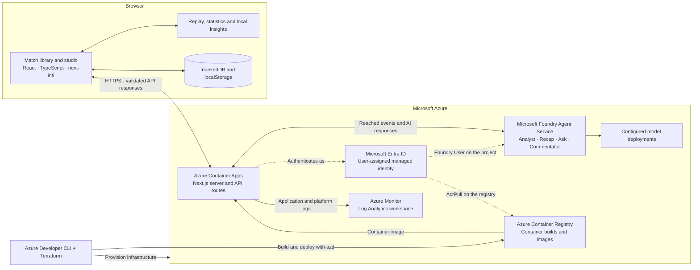

# PitchPulse

A football match analysis studio for replaying recorded events, exploring tactical patterns, and saving notes. PitchPulse combines deterministic match analysis with [Microsoft Foundry agents](#microsoft-foundry-agents) for tactical insights, recaps, questions, and commentary.

The interface supports seven languages and three perspectives: Casual Fan, Analyst, and Player Focus. Match libraries and notes stay in the browser, which runs replay and rule-based insights locally. The pitch's continuous movement is illustrative. See [DESIGN.md](src/web/DESIGN.md) for the visual specification.

[Architecture](#architecture) · [Development tools](#development-tools) · [Microsoft Foundry agents](#microsoft-foundry-agents) · [Deploy to Azure](#deploy-to-azure)

Repository layout:

- [src/web/](src/web/) is the whole Next.js app: source, tests, scripts, data and its `Dockerfile`. Run npm commands there.
- [infra/](infra/) (Terraform) and [azure.yaml](azure.yaml) make the repository an Azure Developer CLI template; see [Deploy to Azure](#deploy-to-azure).

## Architecture

The browser runs the replay clock, statistics, illustrative movement, and local insights. Azure Container Apps hosts the Next.js server and API routes. When AI analysis is requested, the browser sends only the events reached so far; the server validates them, calls Microsoft Foundry, and checks the returned numbers and evidence before displaying the response.



### Microsoft technology stack

| Technology | Role in PitchPulse | Implementation |
| --- | --- | --- |
| **Microsoft Foundry Agent Service** | Hosts four versioned prompt agents with structured outputs. Their model deployments are selected through `FOUNDRY_MODEL_DEPLOYMENT` and the optional fast deployment setting. | [Agent definitions](src/web/lib/agents/definitions.ts), [provisioning script](src/web/scripts/provision-agents.ts) |
| **Azure AI Projects SDK** (`@azure/ai-projects`) | Connects the server to the Foundry project and invokes agents through the Responses API. | [Foundry client](src/web/lib/foundry/client.ts), [agent runner](src/web/lib/foundry/run-agent.ts) |
| **Microsoft Entra ID and Azure Identity SDK** (`@azure/identity`) | Authenticates the deployed app with a user-assigned managed identity. Its roles are `AcrPull` on the registry and `Foundry User` on the single Foundry project. | [Identity and role assignments](infra/main.tf), [credential setup](src/web/lib/foundry/client.ts) |
| **Azure Container Apps** | Runs the Next.js standalone container behind HTTPS, with one warm replica and runtime environment configuration. | [Container App infrastructure](infra/main.tf), [Dockerfile](src/web/Dockerfile) |
| **Azure Container Registry** | Builds the production container remotely and stores the images deployed to Container Apps. | [Azure service definition](azure.yaml), [registry infrastructure](infra/main.tf) |
| **Azure Monitor / Log Analytics** | Collects Container Apps logs for operational checks and troubleshooting. | [Logging configuration](infra/main.tf) |
| **Azure Cost Management** | Provides an optional monthly budget alert for the Foundry resource group. | [Budget configuration](infra/main.tf) |
| **Azure Developer CLI (`azd`) and Azure CLI** | Coordinate provisioning, deployment, local Azure sign-in, and operational commands. Terraform declares the infrastructure. | [Azure template](azure.yaml), [deployment guide](#deploy-to-azure) |
| **TypeScript** | Defines typed contracts across the React interface, match engine, validation, and Foundry integration. | [App configuration](src/web/tsconfig.json), [match contracts](src/web/lib/match/types.ts) |

## Development tools

| Tool | Use in development |
| --- | --- |
| **GitHub** | Repository hosting, version control, collaboration, and code review. |
| **GitHub Copilot** | AI assistance with code authoring, explanations, and refactoring during development. |
| **Visual Studio Code (VS Code)** | Editor for the TypeScript and React application, debugging, and integrated terminal workflows. |
| **Node.js and npm** | Local runtime, dependency installation, development server, and project scripts. |
| **Docker and Terraform** | Reproducible application packaging and declarative Azure infrastructure. |
| **Node.js test runner, tsx, and ESLint** | Automated domain and component checks, TypeScript test execution, and linting. |

The development workflow uses GitHub Copilot alongside VS Code; the application's AI analysis runs through Microsoft Foundry. Contributor instructions live in [AGENTS.md](AGENTS.md) and [src/web/AGENTS.md](src/web/AGENTS.md).

## Microsoft Foundry agents

| Agent | Where | What it adds |
| --- | --- | --- |
| Tactical Analyst (`pitchpulse-analyst`) | Pitch → **Analyze** (loads on the pitch, then opens a result dialog), or Insights → **Analyze this moment** | One to four insight cards: pressing, build-up, turnovers, flank preference, momentum, player involvement |
| Recap Writer (`pitchpulse-recap`) | Half/full-time recap → **Write AI recap** | A narrative story, evidence-linked turning points, per-team notes and, at half-time only, questions for the second half |
| Ask the Analyst (`pitchpulse-ask`) | **Ask** tab, and **Draft with AI** in the note editor | Answers about the reached match, including tactical patterns, suggested adjustments and a qualitative outlook for questions about a team's chances, never a number. The agent calls PitchPulse function tools, which see only the processed prefix |
| Live Commentator (`pitchpulse-commentator`) | Live commentary → **Narrate with AI** | One casual line per recent meaningful event, shown under the unchanged templated row |

## Deploy to Azure

The repository is an [Azure Developer CLI](https://learn.microsoft.com/azure/developer/azure-developer-cli/) (azd) template. `azd up` provisions [infra/](infra/) with Terraform and deploys [src/web](src/web/) to Azure Container Apps. The image is built in Azure from [src/web/Dockerfile](src/web/Dockerfile) as a Next.js standalone server.

It creates one resource group, `rg-<environment>`, containing:
- **Container App:** one always-warm replica, 0.5 vCPU and 1 GiB, with an HTTPS endpoint.
- **Container Registry:** Basic.
- **Container Apps environment** and a **Log Analytics workspace**.
- **User-assigned managed identity:** gets **AcrPull** on the registry, and **Foundry User** scoped to your one Foundry project. There are no keys or secrets.

It also creates a monthly cost alert on your Foundry resource group, which notifies subscription Owners. Your Foundry account and project are only looked up, so `azd down` never deletes them.

Prerequisites:
- **Tools:** azd, Terraform 1.9 or later, and the Azure CLI.
- **Sign-in:** run `az login` and `azd auth login`. Terraform authenticates through the Azure CLI.
- **Permissions:** Owner or User Access Administrator on the subscription, to create the role assignments.
- **One-time setup:** `az provider register --namespace Microsoft.ContainerRegistry --wait`.

```bash
azd env new pitchpulse-demo --location southeastasia
azd env set FOUNDRY_PROJECT_ENDPOINT "https://<account>.services.ai.azure.com/api/projects/<project>"
azd env set FOUNDRY_AGENT_VERSION 5   # optional
azd env set AI_BUDGET_AMOUNT 25       # optional
azd up
```

| Setting | Effect |
| --- | --- |
| `FOUNDRY_PROJECT_ENDPOINT` | Connects AI analysis to the Foundry project and gives the app's identity access to that project. |
| `FOUNDRY_AGENT_VERSION` | Pins all four agents to one provisioned version. Unset uses each agent's latest version. |
| `AI_BUDGET_AMOUNT` | Monthly cost alert in US dollars on the Foundry resource group. The default is 25; 0 creates none. |

Afterwards:
- `azd deploy` ships code changes.
- `azd provision` applies infrastructure changes and never rolls back the deployed image.
- `azd down` deletes the environment.
- After provisioning new agent versions, run `azd env set FOUNDRY_AGENT_VERSION <n>` and then `azd provision`.

Notes:
- **Region:** use the Foundry project's region for `--location`, to keep agent calls short.
- **Access:** the app is public. AI requests stay on demand, and the agents route rate-limits each visitor by the client address that Container Apps supplies. The single replica keeps that in-memory limit accurate.
- **Cost:** roughly US$15 a month (one idle replica about US$10, the registry about US$5) plus Foundry token usage.
- **State:** Terraform state stays local in `.azure/<environment>`. Configure remote state before sharing an environment. azd's Terraform support is in beta.
- **Troubleshooting:**
  - If the first AI request fails with a Foundry error (403 in `az containerapp logs show`), the role assignment may still be propagating; retry after a few minutes.
  - Older azd releases (for example 1.23) fail the remote build with `InvalidCorrelationRequestId`. Update azd, or start Docker so azd can build locally, or build and roll out with the Azure CLI using the values from `azd env get-values`:

    ```bash
    az acr build --registry "$AZURE_CONTAINER_REGISTRY_NAME" --image "pitchpulse/web-$AZURE_ENV_NAME:$TAG" src/web
    az containerapp update -n "$SERVICE_WEB_NAME" -g "$AZURE_RESOURCE_GROUP" --image "$AZURE_CONTAINER_REGISTRY_ENDPOINT/pitchpulse/web-$AZURE_ENV_NAME:$TAG"
    ```
